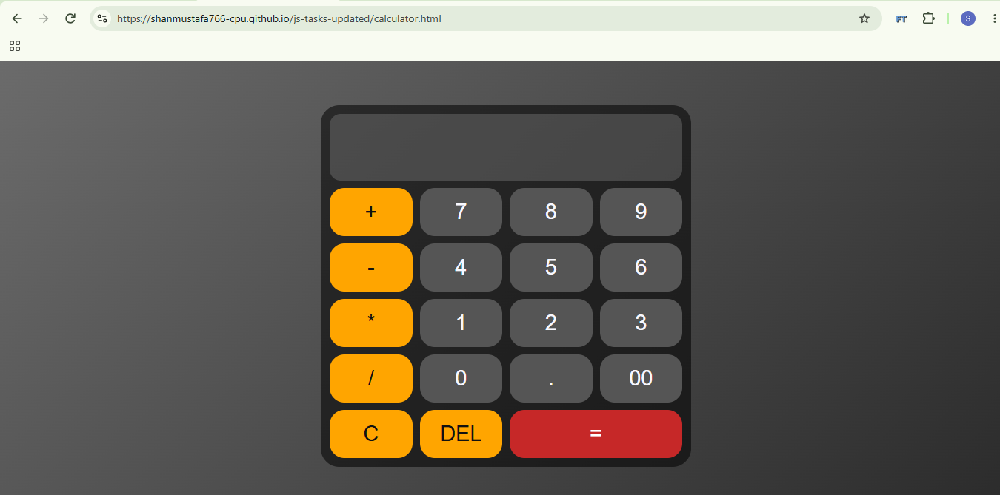
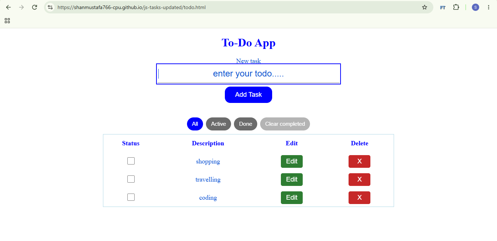
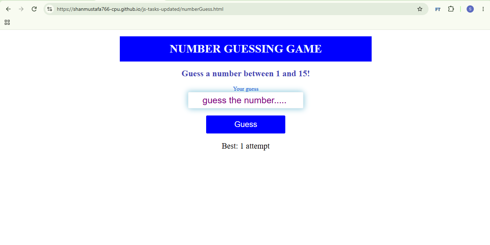

# JS Tasks

Three small vanilla-JavaScript apps, built while learning.

## Apps

### 🧮 Calculator
Own expression parser (no `eval`, no libraries), operator precedence, negative numbers, divide-by-zero handling, keyboard support, screen-reader announcements.
**[Try it](https://shanmustafa766-cpu.github.io/js-tasks-updated/calculator.html)**

### ✅ To-Do App
Add / edit / delete tasks, filters (All / Active / Done), clear completed, `localStorage` persistence, two-tab sync, inline editing, focus management.
**[Try it](https://shanmustafa766-cpu.github.io/js-tasks-updated/todo.html)**

### 🎯 Number Guessing Game
Guess a number between 1 and 15, attempt tracking, best score in `localStorage`, input validation, repeat-guess detection.
**[Try it](https://shanmustafa766-cpu.github.io/js-tasks-updated/numberGuess.html)**

## Stack

Vanilla HTML, CSS, and JavaScript. No build step, no dependencies.

## Run locally

Open any `.html` file in a browser.
